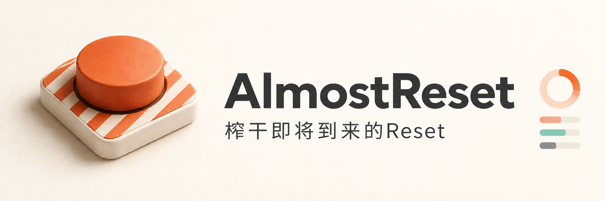

<p align="center">
  
</p>

<p align="center">
  <a href="https://github.com/caopulan/AlmostReset/releases/latest"></a>
  
  
  <a href="LICENSE"></a>
</p>

<p align="center">
  <a href="https://github.com/caopulan/AlmostReset/releases/latest">下载应用</a> ·
  <a href="docs/USAGE.zh-CN.md">使用指南</a> ·
  <a href="https://github.com/caopulan/AlmostReset/issues">反馈问题</a>
</p>

<h2 align="center">榨干即将到来的Reset</h2>

额度还剩不少，下一次 Reset 却快到了。你可以趁这段时间多开几个 Codex 会话，换上更大的模型、提高推理强度、开启更快的速度，把本轮剩余额度投入更多任务。

**AlmostReset 负责在重置到来时，按计划收住这些高消耗会话。** 检测到额度恢复后，它会按规则停止部分会话，或降低模型、推理强度和速度，让需要保留的任务继续运行。

无论是额度周期到期，还是服务商额外提供的 Reset，只要本机 Codex 报告的剩余额度增加，就能触发本轮规则。你可以提前安排哪些任务停、哪些任务降配置继续，让重置前的集中执行在新一轮额度到来时及时调整。

## ⚡ 重置前放开跑，重置后按规则调整

例如，临近 Reset 时，你同时启动了代码重构、测试补全和资料整理等多个会话。它们可以先使用大模型、高推理强度或快速模式；重置之后，AlmostReset 按下面的安排处理：

| 重置前的会话 | 预先设定的规则 | 检测到重置后 |
|---|---|---|
| 一批使用 `gpt-6-astra` 的任务 | 匹配模型，选择停止 | 中断这些会话 |
| 需要继续的重点任务 | 指定会话，调整模型与推理强度 | 换成 `gpt-6-sol`、`xhigh`，发送「继续」 |
| 开启快速模式的任务 | 匹配 `fast`，调整速度 | 切回标准速度，继续执行 |

把重点任务的规则排在前面，再安排其他会话。每个会话只执行第一条命中的启用规则，因此可以先保留个别任务，再批量处理其余高消耗会话。

## ✨ 让这套安排落地

- **跟踪剩余额度**：主窗口和菜单栏显示用量，随时查看最近刷新时间。
- **圈定高消耗会话**：按模型、推理强度、速度和状态组合条件，也可直接勾选任务或粘贴会话链接。
- **先看结果再启动**：预览匹配会话、当前配置与预计动作，拖动整张卡片调整优先级。
- **停止或降配置继续**：修改模型、推理强度和速度，发送自定义提示词，默认「继续」。
- **覆盖提前重置**：任何有效的剩余额度提升都能触发，无需等到预计到期时间。
- **一轮执行后结束**：首次检测到重置便处理一轮，然后停止监听；下次集中执行时再启动。
- **原生 macOS 体验**：支持菜单栏、中文和英文，默认中文。

AlmostReset 当前是一款面向 **Codex** 的独立 macOS 应用。你在 Codex 中启动任务、提高配置，AlmostReset 负责监控额度并在重置后执行已设定的调整。

## 📦 安装

从 [GitHub Releases](https://github.com/caopulan/AlmostReset/releases/latest) 下载 **AlmostReset-0.8.1-macOS-arm64.dmg**，打开后将 **AlmostReset.app** 拖入 **Applications**。

需要 **macOS 14 或更高版本、Apple Silicon Mac**，以及已安装并登录的 Codex CLI。控制 Codex 桌面端会话时，请保持 Codex 桌面应用运行。应用会自动寻找 CLI；设置页显示连接成功后，无需手动选择路径。

当前发布包采用本地临时签名，**尚未经过 Apple Developer ID 签名和公证**。如果首次打开被系统拦截，请先确认下载来源，再按照 [Apple 官方说明](https://support.apple.com/zh-cn/102445)操作。

更新前退出旧版，再替换应用。已保存的规则保留；重新打开后监听处于待启动状态。

### 应用内更新

从 0.8.0 起，应用默认在启动后检查更新，并每小时自动检查一次。发现正式版后会下载、验证签名，在空闲时安装并重启，保留规则和设置。监听重置、执行动作、刷新或保存规则期间会延后安装。可在「设置 → 应用更新」关闭自动更新，或点击「检查更新」。

0.7.x 需先手动安装一次 0.8.0，之后即可使用自动更新。安装位置没有写入权限时，系统可能要求授权。更新后的应用仍以待启动状态打开。

## 🚀 安排一次重置前的集中执行

1. 打开 AlmostReset，确认已读取本机 Codex 的用量和会话。
2. 点击「新建规则」，指定重点会话，或用模型、推理强度、速度等条件圈定一批任务。
3. 设置重置后的动作：停止，或调整配置并发送提示词继续。将需要优先保留的会话放在前面。
4. 点击会话数量检查预计动作，再点击「启动」，建立本轮额度基线并开始监听。
5. 在 Codex 中多开会话、使用更大的模型或更快的速度。条件规则会在触发时重新匹配，也能覆盖监听后新启动的任务。
6. 检测到额度提升后，AlmostReset 执行一轮调整；到活动记录查看结果，需要下一轮时再次启动。

应用按设置的检查间隔轮询，**在首次读到额度提升时开始处理**。实际响应时间取决于检查间隔、连接状态和动作执行时间。

条件规则针对运行中的会话；指定会话可选择运行中或最近 30 分钟活跃的会话。详情见[匹配范围与优先级](docs/USAGE.zh-CN.md#匹配范围与优先级)。

### 从预设开始

| 预设 | 匹配对象 | 重置后的动作 |
|---|---|---|
| 停止 6-astra | 模型为 `gpt-6-astra` | 停止会话 |
| 快速 → 标准并继续 | 速度为 `fast` | 改为标准速度，发送「继续」 |
| 6-astra → 6-sol · xhigh | 模型为 `gpt-6-astra` | 改为 `gpt-6-sol`、`xhigh`，发送「继续」 |

预设只填充草稿，选中后可继续修改条件、配置和提示词。「快速」预设不会同时匹配 `ultrafast`；如需同时处理两者，可在速度条件中勾选这两个值。

## 使用前了解

**「停止会话」与「停止监听」是两个动作。** 前者在规则触发时中断会话，并请求暂停自动续跑目标；后者仅取消 AlmostReset 本轮等待。调整后继续会开始新的 Codex 工作，可能消耗账号额度。

应用不需要额外 API Key，也不保存登录凭据。规则、提示词和简要活动记录存放在本机。Codex 桌面端会话控制依赖其私有本地协议，升级 Codex 后可能需要更新适配；无法控制的会话会显示原因。详见[使用指南](docs/USAGE.zh-CN.md)。

## 🛠 从源码构建

需要 Swift 6 工具链及 macOS。下载源码并构建应用：

```bash
git clone https://github.com/caopulan/AlmostReset.git
cd AlmostReset
./scripts/build-app.sh
open dist/AlmostReset.app
```

运行测试与发布构建检查：

```bash
./scripts/check.sh
```

生成 DMG：

```bash
./scripts/build-dmg.sh
```

DMG 脚本使用已构建的 `dist/AlmostReset.app`，输出安装镜像与 SHA-256 校验文件。发布的预编译包为 arm64；其他架构未提供经过验证的安装包。

## 文档与参与

- [中文使用指南](docs/USAGE.zh-CN.md)：重置判定、条件组合、会话范围、设置与本地数据。

欢迎通过 [Issue](https://github.com/caopulan/AlmostReset/issues) 提交问题或建议，也欢迎提交 PR。反馈时请提供应用版本、macOS 版本、Codex 版本和复现步骤，并移除账号信息及会话中的敏感内容。

## 许可证

[MIT](LICENSE) © 2026 Pu Cao。更新组件使用 [Sparkle](https://sparkle-project.org/)，其许可声明随应用分发，并保存在 [licenses/Sparkle-LICENSE.txt](licenses/Sparkle-LICENSE.txt)。
